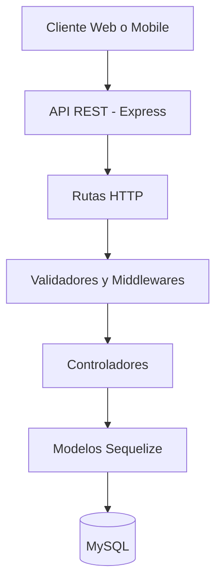

<div align="center">

# 🏋️ AnywhereFitness Server

### 💪 Tu entrenamiento y nutrición, conectados en una sola API.

**Backend REST para una plataforma de fitness: usuarios, rutinas, ejercicios y seguimiento nutricional.**


</div>

---

## 📌 ¿Qué es AnywhereFitness Server?

**AnywhereFitness Server** es una API REST desarrollada con **Node.js, Express, Sequelize y MySQL** para centralizar la información de una plataforma de entrenamiento físico y nutrición.

El backend permite registrar e iniciar sesión de usuarios, configurar perfiles deportivos, administrar rutinas semanales, consultar ejercicios y registrar el consumo diario de alimentos y macronutrientes.

> 🎯 **Objetivo:** construir una base de servicios reutilizable para aplicaciones web o móviles de fitness, separando la lógica de negocio, el acceso a datos y las rutas HTTP.

---

## ✨ Funcionalidades principales

- 🔐 **Registro e inicio de sesión:** validación de datos, contraseñas protegidas mediante hash con bcrypt y emisión de tokens JWT.
- 👤 **Perfiles de usuario:** datos personales, roles y tipo de plan (`gratuito` o `premium`).
- 📝 **Onboarding deportivo:** objetivo, experiencia, lugar de entrenamiento, frecuencia, días disponibles y observaciones.
- 🏋️ **Rutinas semanales:** creación, consulta y reemplazo de rutinas organizadas por día.
- 💪 **Catálogo de ejercicios:** creación y consulta de ejercicios con categoría y enlaces de video cuando están disponibles.
- 🥗 **Perfil nutricional:** objetivos calóricos y distribución de proteínas, carbohidratos y grasas.
- 🍽️ **Registro de comidas:** alimentos consumidos, porciones, calorías y macronutrientes.
- 📊 **Seguimiento nutricional:** consulta del día e historial para gráficas diarias, semanales o mensuales.
- 🗄️ **Persistencia relacional:** modelos y asociaciones mediante Sequelize sobre MySQL.

---

## 🛠️ Tecnologías utilizadas

| Tecnología | Uso en el proyecto |
| :--- | :--- |
| **Node.js** | Entorno de ejecución del servidor |
| **Express 5** | Rutas, middlewares y API REST |
| **JavaScript** | Desarrollo de la lógica backend |
| **MySQL** | Base de datos relacional |
| **Sequelize 6** | ORM, modelos, relaciones y transacciones |
| **mysql2** | Conexión entre Sequelize y MySQL |
| **JSON Web Token (JWT)** | Emisión y verificación de tokens |
| **bcrypt** | Hash y validación de contraseñas |
| **express-validator** | Validación de datos |
| **dotenv** | Variables de entorno |
| **cors** | Configuración CORS |
| **nodemon** | Desarrollo con reinicio automático |

---

## 🧩 Módulos del sistema

| Módulo | Descripción |
| :--- | :--- |
| 🔑 **Autenticación** | Registro, login y logout |
| 👥 **Usuarios** | Consulta de usuarios y perfiles |
| 🎯 **Onboarding** | Preferencias y planificación del entrenamiento |
| 🏋️ **Ejercicios** | Catálogo y registro de ejercicios |
| 📅 **Rutinas** | Rutinas semanales, días, series y repeticiones |
| 🥦 **Alimentos** | Búsqueda en la biblioteca nutricional |
| 🔥 **Nutrición** | Registro de calorías y macronutrientes |
| 📈 **Historial** | Datos nutricionales para reportes |

---

## 📁 Estructura del proyecto

```text
AnywhereFitnessServer/
├── config/
│   └── database.js
│
├── controllers/
│   ├── authController.js
│   ├── exersiceController.js
│   ├── onboardingController.js
│   ├── usercontroller.js
│   └── weeklyRoutineController.js
│
├── middleware/
│   ├── adminMiddleware.js
│   └── authMiddleware.js
│
├── models/
│   ├── index.js
│   ├── Usuario.js
│   ├── ExerciseTypes.js
│   ├── Exersice.js
│   ├── Food.js
│   ├── OnboardingProfile.js
│   ├── OnboardingDay.js
│   ├── OnboardingNutrition.js
│   ├── NutritionDay.js
│   ├── NutritionEntry.js
│   ├── WeeklyRoutine.js
│   ├── WeeklyRoutineDay.js
│   └── WeeklyRoutineExercise.js
│
├── routes/
│   ├── authRoutes.js
│   ├── exersiceRoutes.js
│   ├── onboardingRoutes.js
│   ├── userRoutes.js
│   └── weeklyRoutineRoutes.js
│
├── validators/
│   └── authValidator.js
│
├── server.js
├── package.json
└── package-lock.json
```

> Los nombres de archivos se mantienen tal como aparecen en el código fuente original.

---

## 🧠 Arquitectura del backend

La aplicación utiliza una estructura modular basada en la separación de responsabilidades.



### Componentes principales

- **Routes:** definición de endpoints HTTP.
- **Controllers:** procesamiento de solicitudes y lógica de negocio.
- **Models:** representación de entidades y relaciones.
- **Middleware:** autenticación y autorización.
- **Validators:** validación de datos recibidos.
- **Config:** configuración de base de datos.

---

## 🌐 Endpoints de la API

**URL base local:** `http://localhost:3000`

### 🔐 Autenticación

| Método | Endpoint | Acción |
| :--- | :--- | :--- |
| `POST` | `/api/auth/register` | Registrar usuario |
| `POST` | `/api/auth/login` | Iniciar sesión y obtener JWT |
| `POST` | `/api/auth/logout` | Solicitar cierre de sesión |

### 👤 Usuarios y onboarding

| Método | Endpoint | Acción |
| :--- | :--- | :--- |
| `GET` | `/api/user/users` | Listar usuarios |
| `GET` | `/api/user/:id` | Consultar un usuario |
| `POST` | `/api/users/:id/onboarding` | Guardar perfil inicial |
| `GET` | `/api/users/:id/onboarding` | Consultar perfil inicial |
| `GET` | `/api/users/:userId/onboarding-days` | Consultar días de entrenamiento |

### 🏋️ Ejercicios y rutinas

| Método | Endpoint | Acción |
| :--- | :--- | :--- |
| `POST` | `/api/exercise` | Crear ejercicio |
| `GET` | `/api/exercise/search` | Consultar ejercicios |
| `GET` | `/api/routines/:userId` | Consultar rutina semanal |
| `POST` | `/api/routines/:userId` | Crear o reemplazar rutina |
| `PATCH` | `/api/routines/:userId/metadata` | Actualizar título de rutina |

### 🥗 Nutrición

| Método | Endpoint | Acción |
| :--- | :--- | :--- |
| `GET` | `/api/foods/search?query=arroz` | Buscar alimentos |
| `POST` | `/api/users/:userId/nutrition` | Registrar consumo |
| `GET` | `/api/users/:userId/nutrition?date=2026-10-30` | Consultar consumo por fecha |
| `GET` | `/api/users/:userId/nutrition/daily-kcal` | Consultar objetivos nutricionales |
| `GET` | `/api/users/:userId/nutrition/history?range=week` | Consultar historial |

**Parámetros de historial:** `day`, `week` y `month`.

> ⚠️ **Estado de seguridad:** existen middlewares JWT y de autorización, pero aún no están aplicados a las rutas. Es necesario proteger los endpoints antes de utilizar la API en producción.

---

## 🗄️ Base de datos

El proyecto utiliza **MySQL** como motor de base de datos relacional y **Sequelize** como ORM.

### Modelos principales

| Área | Modelos |
| :--- | :--- |
| 👤 **Usuarios** | `Usuario` |
| 📝 **Onboarding** | `OnboardingProfile`, `OnboardingDay`, `OnboardingNutrition` |
| 💪 **Ejercicios** | `Exercise`, `ExerciseType` |
| 🏋️ **Rutinas** | `WeeklyRoutine`, `WeeklyRoutineDay`, `WeeklyRoutineExercise` |
| 🥗 **Nutrición** | `Food`, `NutritionDay`, `NutritionEntry` |

### Características

- Modelado de entidades.
- Relaciones entre tablas.
- Consultas mediante ORM.
- Persistencia de perfiles deportivos.
- Asociación de ejercicios a rutinas.
- Registro de información nutricional.
- Transacciones para operaciones de rutinas.

---

## 📦 Instalación y ejecución

### Requisitos previos

- Node.js.
- npm.
- MySQL.
- Git.
- Visual Studio Code u otro editor.

### 1. Clonar el repositorio

Reemplaza la URL por la dirección real de tu repositorio.

```bash
git clone https://github.com/TU_USUARIO/AnywhereFitnessServer.git
```

### 2. Acceder a la carpeta

```bash
cd AnywhereFitnessServer
```

### 3. Instalar dependencias

```bash
npm install
```

### 4. Crear la base de datos

Ejecuta en MySQL:

```sql
CREATE DATABASE anywherefitnessdb;
```

### 5. Configurar variables de entorno

Crea un archivo `.env` en la raíz del proyecto.

```env
PORT=3000
DB_HOST=localhost
DB_NAME=anywherefitnessdb
DB_USER=tu_usuario_mysql
DB_PASS=tu_contrasena_mysql
JWT_SECRET=tu_clave_secreta_segura
```

> Nunca publiques contraseñas, secretos JWT ni archivos `.env` con valores reales.

### 6. Ejecutar el servidor

```bash
npm run dev
```

El servidor utiliza `nodemon` para facilitar el desarrollo.

**Dirección local:**

```text
http://localhost:3000
```

---

## 🧪 Ejemplos de uso

### 🔐 Registro de usuario

```bash
curl -X POST http://localhost:3000/api/auth/register \
  -H "Content-Type: application/json" \
  -d '{
    "nombre": "Usuario Demo",
    "email": "demo@example.com",
    "password": "EjemploSeguro123",
    "rol": "usuario",
    "tipo_plan": "gratuito"
  }'
```

### 🔑 Inicio de sesión

```bash
curl -X POST http://localhost:3000/api/auth/login \
  -H "Content-Type: application/json" \
  -d '{
    "email": "demo@example.com",
    "password": "EjemploSeguro123"
  }'
```

El inicio de sesión genera un token JWT con expiración configurada de 2 horas.

### 🏋️ Crear una rutina semanal

```bash
curl -X POST http://localhost:3000/api/routines/1 \
  -H "Content-Type: application/json" \
  -d '{
    "title": "Rutina de fuerza",
    "sourceType": "free_manual",
    "days": {
      "lun": [
        {
          "name": "Sentadilla",
          "weight": "60",
          "sets": 4,
          "reps": "8",
          "rest": 90,
          "note": "Priorizar técnica"
        }
      ],
      "mar": []
    }
  }'
```

La operación utiliza transacciones de Sequelize para mantener la consistencia de la información.

---

## 🔒 Seguridad

El proyecto incorpora funcionalidades de autenticación y mecanismos de seguridad como:

- Hash de contraseñas con bcrypt.
- Generación de tokens JWT.
- Validación de credenciales.
- Middlewares de autenticación.
- Middleware de autorización por roles.
- Configuración mediante variables de entorno.

### Pendientes de seguridad

- [ ] Aplicar middleware JWT a los endpoints privados.
- [ ] Restringir el acceso por usuario y rol.
- [ ] Mejorar las validaciones de entrada.
- [ ] Configurar correctamente los orígenes CORS.
- [ ] Evitar exposición de errores internos.
- [ ] Incorporar pruebas de seguridad.
- [ ] Proteger credenciales y datos personales.

**Importante:** antes de publicar este proyecto, se deben excluir los archivos `.env` y las exportaciones SQL que contengan datos personales.

### Archivo `.gitignore` recomendado

```gitignore
node_modules/
.env
.env.*
!.env.example
*.log
```

---

## 🧠 Aprendizajes y retos técnicos

Durante el desarrollo de **AnywhereFitness Server**, he fortalecido mis conocimientos en:

- Desarrollo backend con Node.js.
- Creación de API REST con Express.
- Arquitectura modular y separación de responsabilidades.
- Diseño de modelos relacionales.
- Integración de MySQL con Sequelize.
- Consultas y transacciones de base de datos.
- Implementación de autenticación JWT.
- Hash y validación de contraseñas.
- Gestión de variables de entorno.
- Manejo de solicitudes y respuestas HTTP.
- Desarrollo de servicios para aplicaciones web y móviles.

---

## 🚧 Estado del proyecto

**Estado actual: en desarrollo.**

Los módulos se encuentran implementados en el código, pero todavía se requieren pruebas de integración y validaciones de seguridad antes de utilizar el backend en producción.

---

## 🎯 Próximas mejoras

- [ ] Proteger todos los endpoints privados con JWT.
- [ ] Implementar autorización por recursos y roles.
- [ ] Incorporar pruebas unitarias.
- [ ] Agregar pruebas de integración.
- [ ] Documentar endpoints con Swagger / OpenAPI.
- [ ] Implementar paginación y filtros.
- [ ] Mejorar gestión de errores.
- [ ] Implementar migraciones de base de datos.
- [ ] Configurar despliegue en la nube.
- [ ] Implementar registro de eventos y monitoreo.
- [ ] Integrar un frontend web o aplicación móvil.

---

## 👨‍💻 Autor

**Juan David López Patiño**

*Full Stack Developer | Backend Developer*

Desarrollador de software interesado en el diseño y construcción de aplicaciones, servicios backend, bases de datos y soluciones tecnológicas escalables.

### 📫 Contacto

- 🐙 **GitHub:** [@juand4a](https://github.com/juand4a)
- 💼 **LinkedIn:** [Juan David López Patiño](https://www.linkedin.com/in/juan-david-lopez-pati%C3%B1o-6895b3272)
- 📧 **Email:** [juandavidlopezp2004@gmail.com](mailto:juandavidlopezp2004@gmail.com)

---

<div align="center">

### 🏋️ AnywhereFitness Server

**Entrena mejor • Organiza tus rutinas • Monitorea tu progreso**

*Backend desarrollado con Node.js, Express, Sequelize y MySQL.*

</div>
